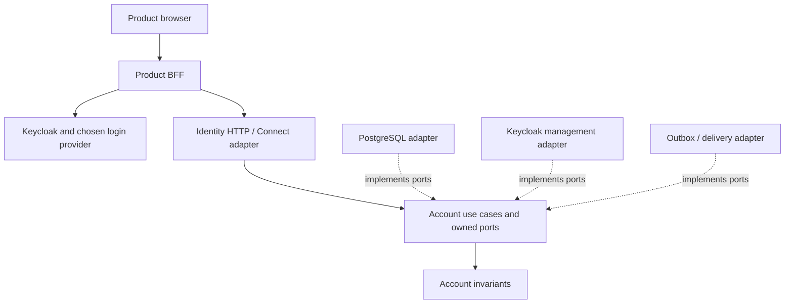

# Identity Service: architecture and implementation plan

## 1. Assignment, outcome and decision status

Build the foundation for a substantial identity product with explicit ownership,
Clean Architecture, SOLID, DDD and DRY. The owner selected the expanded service
direction: stable accounts, binding and account lifecycle, integration events,
SDKs, public Get Modular composition, Engineering Foundation from the first
substantive source, and later qualified Extension Foundation / Live Module Updates
integration. A limited first delivery must preserve these boundaries.

**This delivery is a reviewed planning Draft PR, not implementation or production
admission.** It changes no existing product authentication, account, credential,
balance, deployment or accepted upstream ADR. Runtime phases below are future
work. The owner also requested a separate Review Router integration plan; that
consumer owns its implementation and migration.

The intended user experience is **Continue with GitHub** or **Continue with
GitLab**, directly, without a Google account or intermediate Google login.
Keycloak brokers the selected provider. Review Router can then continue into its
own repository connection consent. These are separate grants inside one coherent
journey; a provider may still require consent, account selection, MFA or application
installation. We must not promise a single provider redirect in every situation.

### Scope of the expanded first product

| Included in the implementation sequence | Boundary |
| --- | --- |
| Stable human accounts and authenticated issuer/subject bindings | Product accounts retain their own identifiers and business data |
| Personal GitHub/GitLab login, passkeys/MFA and recovery integration | Keycloak owns credentials, upstream login bindings and authentication sessions |
| Explicit binding migration, suspension, closure, PII erasure and tombstones | Distinct facts; no automatic merge/split or resurrection |
| Account-security audit, transactional outbox, bounded reconciliation | Account facts only; no global authorization engine |
| Versioned public API and thin SDK, TS and Go consumer compatibility | Generated transport models terminate at consumer adapters |
| Two-replica service/session qualification and an operational deployment profile | Concrete capacity and recovery targets established before a production claim |
| GetTok and Review Router integration contracts | Their changes land in their own repositories and retain local permissions |
| Static modules now, qualified extension/update adapters later | No private foundation imports or competing lifecycle implementation |

Enterprise SCIM, arbitrary customer IdPs, account merge/split, arbitrary policy
languages, active-active global writes, generic plugin hosting, a credential
vault product, custom OAuth cryptography and a second IdP implementation are
outside this first product. Their future integration seams are explicit below.
Self-hosted and Fully Local Orchestrator remain independently operable; this
cloud service is never an unconditional local dependency.

## 2. Source baseline and freshness

Research and a later deep review were performed on 2026-11-26 Europe/Kyiv.
The table preserves the original inspected revisions. The [dated source refresh](../research/modules-source-freshness-2026-11-26.md)
and current BOOTSTRAP record later source/package changes, including Foundation
4.0.2 and FMS 0.4.3. Source identities are audit inputs, not dependency adoption
or a claim that a mutable main cannot advance.

| Owner | Reviewed main | Meaning |
| --- | --- | --- |
| Organization `.github` | `755c8515a5d106402a7e9e2cff621fb1fdc855cf` | Engineering standard, FMS, backend stack, repository admission |
| Engineering Foundation | `fac03920e50ebde038ae415edeb7aa9e3d610ada` | Tooling packages and actual configuration contracts |
| Get Modular | `ae2418b186119c3c84736a6217a9ef25bbfe86cb` | Public static composition and resource ownership |
| Extension Foundation | `65e03edd10cc08194cc4031f857aae302d4b9020` | Empty production package catalog; pending qualification work |
| Live Module Updates | `6e0d5a9e61d76ff7eba7561aea89aa729ce32086` | Private qualification/reference work; no released update coordinator |
| Discord Meeting Assistant | `8fb3d273f4d51eb149e9c310b7edefbee1c72052` | HTTP adapter pattern, not a tooling baseline to copy |
| Platform | `76fc9734f6128b78c7a8b1bc858859fb1cbe835a` | Accepted local principal and authority ownership |
| Orchestrator | `b622026a082a0cccc5ec44eebf12d3f88eef6359` | Open IAM decision, standalone independence |
| Review Router | `1912bb61b54de8af113e0dccd5d4a144382e19e2` | Current Auth.js/provider coupling and existing credential mechanisms |
| GetTok, `777genius/get-tok` | `287d1751564de571a35ec847634a62cb47dd21d7` | Actual consumer fork main; existing Go OIDC and local account/balance ownership |

GetTok's consumer baseline is distinct from the supplemental TokenRouter
upstream snapshot `4ced45bb1854eb3296015fb4b092b64a8c263b46`. The final provenance
check corrected the earlier attribution of that upstream revision to the fork:
upstream is 130 commits ahead in the
[observed comparison](https://github.com/777genius/get-tok/compare/287d1751564de571a35ec847634a62cb47dd21d7...4ced45bb1854eb3296015fb4b092b64a8c263b46).
The actual fork already owns its
[external identity mapping](https://github.com/777genius/get-tok/blob/287d1751564de571a35ec847634a62cb47dd21d7/backend/ent/schema/auth_identity.go)
and [local user/balance model](https://github.com/777genius/get-tok/blob/287d1751564de571a35ec847634a62cb47dd21d7/backend/ent/schema/user.go).
P5 qualifies the actual fork's OIDC adapter and preserves those owners; it does
not presume that unmerged upstream changes are present or require an unrelated
full upstream synchronization.

Read [BOOTSTRAP](../../BOOTSTRAP.md) for exact tooling availability and the
central admission incompatibilities. Read the
[HTTP and modules audit](../research/modules-and-http-source-audit-2026-11-26.md)
for source paths, public exports, npm observations and pending PR boundaries.
The [review record](../reviews/identity-plan-review-2026-11-26.md) distinguishes
independent review from runtime evidence.

Before each implementation phase, refresh relevant heads, open PRs, registry
metadata, published bytes and adopted contracts. Review deltas against this
baseline; do not silently change a lock or accept an unmerged proposal. Prefer
current compatible released artifacts, with exact manifest/lock/integrity pins.
Unpublished contracts are not production dependencies even when their code looks
finished. Exact versioned packed TEST candidates can support the bounded
interoperability work in P1/R0; they do not establish public release or admission.

## 3. Owners and trust boundaries

| Owner | Canonical responsibility | Does not own |
| --- | --- | --- |
| Keycloak | Credential verification, password/passkey/MFA storage, social broker links, OIDC issuance, authentication sessions and credential recovery | Product balances, repository grants, membership, Identity's AccountId |
| Identity account context | AccountId, eligibility/lifecycle revision, authenticated-authority binding, migration proof references, minimal profile, erasure/tombstones | A second password/session/token ledger, tenant roles or repository OAuth tokens |
| Identity provider adapter | Calls supported Keycloak APIs and interprets protocol evidence | Domain decisions or direct Keycloak database access |
| Product BFF/session owner | Browser session, its OAuth transaction and server-held tokens, local logout and refresh concurrency | Global account authority or another product's session |
| Product identity adapter | Exact mapping from authority/account reference to local user/principal | Copying Identity aggregates, email-based account discovery |
| Product authorization owner | Membership, tenant access, roles, capabilities, provider-connection use, API-key policy | Redefining global authentication roots |
| Review Router integrations | GitHub/GitLab connection consent, custody, installations, provider access and webhook effects | Central login credentials or global account recovery |
| Engineering Foundation | Development and conformance tooling | Runtime dependency or product authority |
| Get Modular / EF / LMU | Their qualified composition, artifact and update mechanisms | Account state, authentication permission or durable product revocation |

Keycloak's social binding and Identity's authority binding have different subjects:
Keycloak binds a GitHub/GitLab identity to its realm user; Identity maps the
verified **Keycloak issuer plus subject** to AccountId. Do not build another
writable mirror of all broker bindings in Identity. Any displayed provider metadata
is a read projection, never account ownership evidence by itself.

The Platform [identity dossier](https://github.com/agent-teams-ai/agent-teams-platform/blob/76fc9734f6128b78c7a8b1bc858859fb1cbe835a/docs/domain/contexts/identity/README.md)
and accepted [ADR-0007](https://github.com/agent-teams-ai/agent-teams-platform/blob/76fc9734f6128b78c7a8b1bc858859fb1cbe835a/docs/decisions/0007-platform-strategic-context-map-and-first-project-management-slice.md)
retain PlatformPrincipalId, product eligibility, scoped bindings and historical
authorship. Identity adds an external account authority; it does not delete that
context. Before Platform integration, its owner records the exact mapping and any
scoped successor needed. Do not rewrite accepted ADR bytes or give Identity the
right to grant tenant membership. Orchestrator's
[OD-012](https://github.com/agent-teams-ai/agent-teams-orchestrator/blob/b622026a082a0cccc5ec44eebf12d3f88eef6359/docs/open-decisions/OD-012-identity-authorization-tenant-isolation.md)
remains open; this plan does not settle its graph or local-authority protocols.

The owner's 26 November endorsement of the earlier IAM recommendations is
preserved with all alternatives in the [shared follow-up record](https://github.com/agent-teams-ai/engineering-research/blob/578b166650b916efa51f011598a42fabadaeff2f/docs/studies/identity-provider-evidence.md).
Its product-owned grants, independent personal-local authority and BFF direction
fit this service. An independent AccountId does not by itself prove independent
recovery custody: D3 still owns the enforceable social-root profile.
The endorsement does not select this plan's numerical freshness/retention values
or newly identified D3/D8 alternatives and does not authorize implementation.

Before a later Platform/Orchestrator integration claims support, its owner maps
Identity logout, suspend/close and attachment changes separately from local
principal disable, membership end, grant/delegation revoke and API-key compromise.
Preserve the accepted distinction between subject-bound Run authority,
tenant-autonomous authority, client sponsorship and AR enforcement. A human
logout cannot implicitly revoke every organization's autonomous work; a central
account-status lease cannot replace product grant or last-mile checks.
This is that product's integration contract, not additional scope for Identity's
GetTok/Review Router first delivery.

## 4. Architecture and repository shape

Use one modular TypeScript service plus independently operated Keycloak. A
separate worker entrypoint may run the same account-owned outbox/reconciliation
capability; it is not a new domain or mandatory microservice.

The arrows from inbound adapters are call/dependency direction; outbound adapters
implement application-owned ports. Domain/application do not import Fastify,
Connect, generated Protobuf models, Drizzle, Keycloak SDKs, Get Modular or an
extension runtime. Technical adapters can expose their own technical APIs to
outer composition. Under the adopted CMS, domain/application also do not import
public `contracts/`, including their own feature's public contract surface.
Use-case dependencies belong in application-owned ports; composition maps the
public contract to that semantic boundary. Re-export an owned type where suitable
instead of manufacturing identical DTO copies at every function.

### Proposed source responsibilities

Paths are prospective and appear with their first real feature, never as empty
directories. Use Foundation Plan/Apply/Receipt only for eligible released
package-boundary recipes; author feature layouts and FMS/CMS facts as reviewed
source changes.

| Prospective root | Responsibility and feature ownership |
| --- | --- |
| `packages/identity/src/features/account/` | One cohesive account capability: registration/resolve, binding invariants and account eligibility; internal domain/application/ports/adapters only as needed |
| Same feature, or a justified nested feature | Binding migration and closure/erasure when complexity warrants a declared FMS sub-feature; preserve the actual transaction owner |
| `packages/identity/src/features/account/composition/` | Account-owned descriptors, declarations, implementations and public group; no policies in factories |
| `packages/identity/src/composition/` | Assembles public top-level feature groups and genuine package Host entries; never wires another feature's internals |
| `packages/contracts/src/features/identity-api/` | Versioned wire schemas, generated representations and compatibility fixtures; no aggregates |
| `packages/client/src/features/identity-client/` | Thin client over the published API, bounded transport behavior, credential injection at its edge |
| `apps/server/` | Process composition, config, HTTP/Connect hosting, health and shutdown |
| `apps/worker/` only if deployment needs it | Wires existing owned dispatch/reconciliation features |
| `deploy/keycloak/` and `deploy/` | Reviewed realm/client/theme configuration and exact deployment profile |
| `docs/`, `architecture/` | Decisions, source topology, FMS/CMS adoption, contracts and evidence owned here |

The prospective FMS profile classifies the contracts/client packages explicitly,
including their maintained schema, generated/public transport and feature test
roots. Tests mirror their actual owning feature. Parent feature composition
assembles its direct child's group. Child public contracts/descriptors become
externally visible only through the parent's curated public entrypoint or
composition-contract surface, with each republication edge declared. The package
root assembles the public top-level parent group and never wires the child
directly. Under the separately adopted CMS, `@get-modular/*` imports are confined
to composition and tests, including for resource acquisition; contracts and
adapters expose ordinary typed values/functions. The accepting ADR/profile pins
the reviewed CMS document digest and real Host scope, independently of FMS and
npm versions. BOOTSTRAP records that adoption work.

Account status, binding uniqueness, first consumer attachment/history registration,
proof consumption, command receipt and outbox must be able to commit together. Do not split them into separate contexts
or databases just to mirror nouns. Audit/export and provider integration may be
separate technical features when they have real independent responsibilities.
No generic repository, shared Unit of Work across products, global service bag,
universal event-sourced engine or one package per port.

### HTTP independence: what to take from Discord

Reuse its accepted pattern: small server lifecycle contract and feature-owned
Fastify inbound adapters invoking plain application inputs. Its actual routes
are Fastify plugins; `PlatformHttpHost` only abstracts start/close. Do not import
the Discord application package or copy its older tooling, long timeouts or
meeting-specific transport. Exact evidence is in the HTTP audit.

Use the central [backend reference](https://github.com/agent-teams-ai/.github/blob/755c8515a5d106402a7e9e2cff621fb1fdc855cf/docs/backend-stack.md):
Fastify hosts ordinary HTTP and Connect handlers in the same process. Protobuf
and Buf own the real external API. Dapr is only applicable to a selected private
process boundary. PostgreSQL/Drizzle remain persistence adapters; NATS JetStream
uses the official SDK. Do not install Temporal, Dapr, Centrifugo or OpenFGA
without a concrete owned responsibility in this service.

Replacing Fastify must change the server/inbound adapters and transport tests,
not accounts or use cases. Prove that through source/declaration dependency
checks and a direct application consumer. A second HTTP server implementation
or an in-house router DSL now would add no useful proof. Preserve useful layer
boundaries even if an adapter is small.

## 5. Identity model, uniqueness and lifecycle

`AccountId` is an immutable opaque ID generated by Identity. Proposed storage:
UUIDv7 using a maintained implementation; neither its ordering nor uniqueness
grants access. Expose it to explicitly admitted first-party backends only. A
third-party directory or cross-product enumeration API is not included.

Keep authority ID, issuer URL, provider subject, source incarnation, AccountId,
product UserId, session ID, lifecycle/security revision, binding revision and
module generation as different identities. UUIDv7 selection is an implementation
proposal, not a previously accepted organization-wide ID rule.

### Conceptual records, not a committed database schema

| Record | Required semantics |
| --- | --- |
| Account | Immutable ID; active/suspended/closed eligibility; monotonic account revision; separate monotonic security epoch and authentication cutoff; admitted assurance policy and monotonic stronger-profile admission fact/cutoff; timestamps |
| Authority binding | AccountId plus configured authority, exact verified issuer, case-sensitive subject, source incarnation and binding revision; active/retired status |
| Consumer attachment | Minimal consumer-to-account relation derived from verified user context; ordinary revision, non-reusable admission generation and reattachment cutoff; authorizes only scoped status/delivery, never product membership; retained history also identifies possible closure participants |
| Proof/operation receipt | One-use operation identity, actor, exact target/intended change, expected revisions, bounded expiry and result; hashed opaque proof where applicable |
| Account-owned outbox | Transition and recipient/contract identity committed with the transition; delivery state is separate |
| Security audit | Minimal actor/subject/action/outcome/revision and evidence references; raw credentials excluded |
| Erasure obligation/tombstone | Existing account-owned operation with a bounded participant manifest, own- and product-reported outcomes, idempotent receipts and retained non-reusable references; separate from eligibility |

OIDC identifies a subject in its issuer namespace; email, display name and login
are attributes, not unique identity keys [S1]. Preserve issuer semantics and
exact subject bytes. Any URL canonicalization is a configured connection migration,
not opportunistic normalization of a received `iss`. A GitLab native user ID
must additionally be scoped by the actual GitLab instance/connection identity.

Enforce binding uniqueness in PostgreSQL, not only a pre-insert lookup. In one
transaction: validate current account/binding revisions, consume proof, establish
or change binding, write receipt, audit and outbox. On a uniqueness race, reload
the canonical result; never create an orphan account or redirect a losing link
to somebody else's account. A repeated command with the same idempotency identity
and payload returns its receipt; a different payload is a hard conflict.

An authority's configured source incarnation is operational continuity evidence,
not a user-supplied claim. Recreating a realm, losing an authoritative binding
database, importing an inconsistent backup or changing issuer identity must close
admission until reconciled. Do not use a new incarnation to silently reassign an
old subject. Preserve a minimal binding retirement record for the selected
retention horizon; erasure must not accidentally permit account takeover through
recreation. Exact retention and privacy classification are decisions in section 16.

Suspension is reversible; closure is terminal for that AccountId. Re-enablement
requires fresh sessions and authority evaluation, never resurrection of old
sessions/grants. Erasure removes permitted PII and secrets under their actual
owners; it does not reassign IDs, erase paid balances or cascade product data.
Binding removal, provider disconnect, product logout, global logout, compromise
containment and account closure are distinct commands and UI labels.

## 6. Authentication and the direct GitHub/GitLab journey

1. The product creates a bounded server-side login transaction with an opaque
   nonce/state, PKCE verifier, selected issuer/client, exact callback, local
   return target, client/session generation, and optional connection continuation.
2. Its button starts OIDC Authorization Code + S256 PKCE to Keycloak, using a
   server-allowlisted `kc_idp_hint` for GitHub or GitLab. Keycloak supports this
   redirect mechanism [S2]; it is a UX hint, not authenticated provenance.
3. Keycloak authenticates through that provider and applies its admitted broker
   linking/MFA policy. No Google account is required. Unknown hints cannot choose
   arbitrary identity-provider URLs or bypass assurance.
4. The BFF validates state, code exchange, issuer, client/ID-token audience, nonce,
   token use and timestamps with a maintained OIDC/JOSE library. It consumes the
   login transaction once and rejects a callback for an obsolete generation.
5. The BFF calls Identity's authenticated self-resolution API with an access token
   actually addressed to Identity, obtains the stable account reference and
   current eligibility, and resolves its own local product principal.
6. If repository connection was requested, the product continues into its own
   provider consent/install flow. Cancellation leaves the authenticated account
   usable with an explicit disconnected state. It never silently expands login
   scopes into repository administration.

### Exact token boundary for self-resolution

For the initial BFF profile, configure a separate confidential OIDC client per
product/environment. Its login ID token has that client as audience. The
bootstrap access token carries the narrow `identity.resolve:self` permission
and `identity-api` resource audience through the reviewed client scope/audience
configuration. Identity verifies issuer, signature/algorithm, time, token kind,
audience, scope and the admitted requesting client (`azp` under the selected
Keycloak profile). A role or `azp` never substitutes for audience validation.
Admit an actual human authentication context, not merely a syntactically valid
`sub`: human BFF clients disable service accounts, password grants and other
unneeded flows; workload clients are separately classified and rejected by this
API. Qualify this against actual issued tokens and client configuration.

The request has no arbitrary account or subject selector: Identity derives the
authority/subject from verified access-token context. ID tokens are never API
bearer tokens. A token meant only for Review Router is rejected by Identity.
The resolver token is never a repository credential or a generic credential for
another product API. Later resource-server grants use their own audience and
scope. Qualify actual emitted tokens; configuration labels are not evidence.

Use a deliberately narrow public-subject profile for the trusted first-party
clients initially. Pairwise subjects can differ across clients/sectors [S1];
never assume they all equal the same Keycloak user ID. Enabling pairwise output
requires an explicit owner-controlled alias mapping and migration first.

Self-resolution creates an account only for an authenticated eligible authority
subject and the admitted signup policy. It neither creates tenant memberships
nor claims that a legacy product user with the same email is that account.
Unauthenticated directory lookup and caller-selected issuer discovery are absent.

### Evidence strength: flow control and factor authentication

A new OAuth callback and a verified immutable native user ID establish current
control of the selected provider session in that bounded transaction. They do
not, by themselves, establish when a password, passkey or MFA factor was used.
Keep two application-level evidence classes with verified provenance and the
selected policy version; these are normalized verifier results, not new tokens:

| Evidence class | Established fact | Permitted first-profile use |
| --- | --- | --- |
| Provider/session control | A fresh purpose-bound OAuth/broker round trip or an existing admitted session within its explicitly accepted policy; exact authority/subject, transaction and expiry are verified | Ordinary social login; a new explicit login after ordinary logout; explicitly admitted ordinary bootstrap/add-only linking in section 7; the ordinary legacy-migration profile in D6 |
| Fresh factor authentication | The method, assurance and age of a previously admitted factor are actually proven by the qualified Keycloak flow or upstream assertion | Compromise recovery, privileged root/recovery changes and any operation whose policy promises factor freshness |

A `prompt`/`acr_values` request, an account picker, a token's new `iat`,
or an unclassified broker `auth_time` is not proof of the second class.
Keycloak can record the time of broker login when upstream authentication age
is unavailable. Importing upstream OIDC authentication age is configuration-
and provider-dependent; an OAuth social adapter is not automatically that
profile [S11]. The pinned flow must qualify the provenance of its actual
method/age claims. Unknown evidence cannot be upgraded by a caller label.
A factor enrolled after a weak proof does not retroactively prove earlier
ownership of a legacy account.

P0/R0 select the admitted evidence class, maximum age and transaction lifetime
for each sensitive operation. Ordinary GitHub/GitLab login does not acquire a
universal MFA requirement from this distinction. Recovery after a compromise
cannot be downgraded to ordinary social SSO merely to make it convenient.
If a required stronger proof is unavailable, use the separately authorized
recovery path or reject the action; do not invent a recent-auth claim.

### Review Router-specific contract

Keycloak authenticates; Review Router owns the GitHub App/user authorization or
GitLab OAuth grant, selected provider identity and repository installation.
GitHub App permissions come from the app/installation and user intersection;
ordinary OAuth `repo` scopes are not an accurate substitute [S3]. GitLab
`read_user` is profile access; repository provisioning may require broader
product consent [S4]. Identity stores neither product token.

Preserve Review Router's existing `User.id`, memberships and installations.
Ordinary legacy migration applies only to a local user that has never held a
central binding. Require fresh purpose-bound proof of control of both exact
owners, explicit confirmation and one consumed browser/session-generation
intent. An old local cookie plus the attacker's new central login is insufficient.
For a GitHub-only legacy user, a new product-owned OAuth continuation can supply
provider-session control of the old immutable identity; it cannot certify recent
factor use. D6 makes that residual-risk choice explicit. A cached existing
session can substitute only if its provenance/age actually satisfy the selected
policy; otherwise require the new flow or the stronger admitted proof.

Never infer the native identity from `kc_idp_hint`, email, username or a broker
session-note username. A historical retired/closed binding is not an unbound
legacy account. A new central AccountId with the same GitHub/GitLab identity
cannot overwrite that ownership or recover its retained assets through ordinary
migration. Return a typed repair/transfer-required conflict; separately
authorized transfer/recovery is outside this first migration. Retain the minimal
local ownership restriction for the declared horizon; do not promise indefinite
anti-reuse after all relevant evidence has been purged.

Account linking and repository connection remain independent: disconnecting
GitHub repositories does not delete the global login root; removing a login
root does not automatically transfer a repository connection. Before enabling
new connections, reuse the current Review Router #1007 custody/revision work
where it has landed. Do not duplicate a parallel credential manager.

## 7. Binding changes, MFA, recovery and administration

Use Keycloak's supported broker/account linking flow and its credential UI,
initially with a small theme. Current supported application-initiated linking
is a candidate mechanism to qualify [S5]; this plan does not freeze an obsolete
URL or internal session-note API. Avoid a custom Java authenticator unless a
bounded spike proves the required contract cannot be met through supported
configuration/APIs. Such a finding changes the phase estimate explicitly.

Adding/removing authentication roots, changing recovery material, migrating an
authority binding, closure and administrative containment require explicit
purpose-bound intent and the evidence class assigned to that operation. Sensitive
root/recovery changes and incident recovery require proven factor/assurance
from the qualified flow or the separately authorized recovery procedure.
A freshly refreshed token's `iat` and a broker's new flow timestamp do not
satisfy that requirement by themselves. Require phishing-resistant MFA for
privileged operators. Offer passkeys and recovery appropriate to the selected
profile; enrolling a factor in a newly authenticated session is an enrollment
decision, not retrospective proof of legacy ownership. NIST is guidance for the
threat model, not a compliance certification [S6].

**Separate ordinary bootstrap from security recovery.** For an active,
unrestricted social-only account that has not previously admitted the stronger
factor profile, the P0-approved bootstrap policy may allow first-factor
enrollment and ordinary add-only social-root linking after fresh, purpose-bound
control proof of an existing admitted root, plus proof of the new root/factor
and explicit confirmation. This inherits the declared social-root trust profile;
a stolen live upstream session remains a residual risk. It is not stronger
evidence of historical ownership.

The bootstrap exception cannot remove or replace an established root, weaken
an already admitted assurance policy, be re-entered after a factor was lost or
removed, clear an incident restriction, or transfer a legacy owner. Preserve
the stronger-profile admission fact in account security state; do not derive
bootstrap eligibility from today's factor count. After the stronger profile
has been admitted, sensitive root/recovery changes require its qualified
previously admitted proof or the separately authorized recovery procedure.
Factor authority starts prospectively from its admitted enrollment; a factor
established through the challenged session or after the applicable incident/
recovery trust cutoff cannot satisfy that recovery or establish earlier legacy
ownership. Ordinary social login keeps its session-control profile. Qualify
this enrollment provenance and all enabled channels at P2; if the provider
cannot enforce the selected rule, use the restricted capability profile in D8.

Do not automatically link matching email addresses, even when both providers
report them verified. Prove control of both exact sides at the operation's
admitted evidence strength, consume that proof once, and reject concurrent
competing binding changes. Unlink must preserve an admitted
way to regain access, or enter an explicit recovery/closure flow; two concurrent
unlinks must not remove the final usable authentication root. The adapter must
prove the real Keycloak operation and read-back semantics; a local count alone
cannot enforce a concurrent provider mutation.

Inventory every enabled root-changing channel in the pinned Keycloak profile:
Account Console, broker link/unlink, application-initiated actions, recovery,
administrator APIs and any supported extension. The same invariant must be
enforced across them. Hide-only UI changes do not disable an endpoint. Disable
an unsafe path or qualify a supported enforcement mechanism; if neither is
possible, that capability cannot ship until the bounded provider-extension
decision is resolved. Test competing channels, not just two calls to our adapter.

The initially admitted social account is a declared global authentication root.
Its compromise and upstream recovery have a global account impact. A public
GitHub/GitLab hostname does not prove personal custody. Customer-controlled
GitLab/enterprise IdPs and corporate mailbox recovery must not become unrestricted
roots of a shared A/B account. Keep them disabled for this global-root profile
until scoped provenance/recovery is designed and qualified. This still permits
product-owned self-hosted GitLab repository connections without granting that
server global login or recovery authority.

Keycloak owns credential recovery; Identity owns eligibility and rebinding.
A reset link cannot bypass a suspended/closed Identity account. Email is a
notification/recovery channel only under the declared trust policy, never
ownership evidence sufficient to move an existing product account. Lost all
factors is a separate audited recovery operation, with no heuristic based on
name, email similarity, OS account, an old backup or customer-admin role.

Human/platform service/agent actors and OAuth clients remain distinct. Product
admins cannot delete a global account, edit another customer's factors or gain
Keycloak realm-management roles. Operator APIs require their own narrow clients,
capabilities, audit and step-up. Workload identity authenticates a caller, not an
arbitrary human subject it places in a request. Break-glass recovery is separately
scoped, time-bounded and audited; never a fallback allow when Identity is down.

## 8. Sessions, logout, suspension and freshness

Keycloak remains the authentication-session authority. Product BFFs own local
sessions. Identity does not implement its own refresh-token minting system or
duplicate all Keycloak sessions. An account security epoch is eligibility/version
state, not an OAuth session database.

Every issued product session stores immutable `issuedSecurityEpoch` and
`issuedAttachmentGeneration`, the authority incarnation, and the admitted proof
class/provenance. The account epoch and consumer generation are separate scopes. Revocation events
(including suspend, compromise containment and global logout) advance the
account epoch and an authoritative authentication cutoff; ordinary profile
changes advance account revision without needlessly revoking every session.
At each protected admission, a session must match current-enough account epoch,
consumer attachment generation and authority incarnation. Refreshing a token or status lease never advances the session's
issued epoch. Re-enablement keeps the increased epoch. A final active snapshot
after missed suspend and enable events therefore cannot revive an old session.

A session pins the epoch/generation of the authoritative snapshot actually
accepted at issuance. There is no atomic transaction spanning an Identity read
and a BFF session commit: a still-valid pre-cutoff snapshot can issue only an
old-generation session within the stated stale-admission bound. A newer known
epoch/generation wins immediately, and expiry ends that older admission even
if delivery was lost. A response arriving late cannot extend its deadline.

Once the newer cutoff is known, a new session at that generation requires the
operation's admitted proof after the cutoff; refreshing an old token or lease
cannot upgrade an already issued session. For ordinary global logout, a new
explicit social login may use still-live upstream SSO: it is a new session-
control flow, not proof of new factor use. Compromise/recovery restrictions
require the stronger evidence specified in section 6 and cannot be cleared by
that ordinary flow. Qualify timestamp provenance, granularity and skew;
ambiguous boundary evidence is rejected. Do not promise immediate cross-product
revocation or global logout of GitHub/GitLab's own upstream sessions.

Browsers get protected opaque session cookies; tokens remain server-side.
Use Secure, HttpOnly, a narrow host cookie, an admitted SameSite setting,
session fixation protection and explicit CSRF/origin checks on state changes.
Do not put tokens in URL fragments, logs, localStorage or cross-product cookies.
Two-replica refresh requires a durable claim/version and atomic publication;
logout, revoke or disconnect must win over a late refresh. A process-local
single-flight is insufficient. Reuse the actual product custody owner.

Back-channel logout validates signed logout-token issuer, intended audience,
event, age and replay identity; `sid`/`sub` select only the appropriate local
sessions [S7]. Treat missed logout delivery as a failure mode. Global logout
ends the declared authentication sessions, not product balances or independently
authorized API keys. Those product capabilities retain an explicit compromise
and account-disable policy with their owners.

A live account/attachment lease is not evidence that an individual Keycloak
SSO/client session still exists. If a provider-native logout notification is
lost, workload status refresh may continue to observe an active account. D8 and
consumer R0 must select the exposed control's exact revocation scope and finite
lost-delivery contract. Do not apply the account-wide freshness candidate below
to native single-session logout without an enforcing mechanism. Root removal
and credential recovery also need an explicit session-invalidation scope in
that inventory; ordinary unlink and compromise containment remain distinct.

### Proposed initial freshness contract

Events accelerate revocation; **event receipt alone never proves freshness**.
For protected new admissions, each consumer keeps bounded account-status evidence
from Identity with account, consumer, authority incarnation, account revision/
security epoch, attachment generation/cutoff, observation time and a strict
validity deadline. Proposed initial maximum stale
acceptance is **60 seconds including clock-skew allowance**, pending the phase-0
operational decision and real measurement. A cache may shorten, never extend it.
Expired, missing, contradictory or unavailable required evidence fails closed.
Existing sessions cannot live indefinitely just because an access JWT is valid.

Evidence expiry is anchored to the authoritative snapshot's observation time,
with a bounded absolute `validUntil`; never start a fresh 60-second TTL when a
delayed response or replayed event arrives. The client also records monotonic
request-start time and bounds its usable deadline conservatively by that start
plus the admitted maximum, source expiry, applicable credential expiry and skew.
Response transit consumes the budget. Reject evidence already expired on arrival
or older than a known account revision or attachment generation. Cache and
late-response fences include the exact authority/account/consumer/generation;
a status value for another consumer or an older attachment is not reusable.
Uncertain clock conversion closes admission. These are authenticated API response facts, not a new token format.

Fresh evidence is obtained at login and refreshed on demand, with deduplication,
or in authorized bounded batches for active accounts. The authorization contract
below applies; neither an arbitrary list nor a global scan is permitted. Clock
regression/restore invalidates the local lease. A consumer
restarts with expired evidence until refreshed. Sensitive global operations
read the authoritative account state at their own commit boundary.

### Status and delivery authorization

P2 can start with self-only refresh using a valid server-held user token addressed
to Identity. P4's batch/feed profile uses a **separate workload client**, mapped
by operator-owned configuration to a consumer identity, with `identity-api`
audience and the narrow proposed `identity.status:read` permission. Human OIDC
clients cannot use client credentials to impersonate users. Workload tokens and
self tokens are not interchangeable; account management has separate authority.

A successful authenticated self-resolution records only the minimal
`(consumerId, AccountId, authorityIncarnation)` attachment justified by the
verified subject and admitted requesting OIDC client. The consumer's workload
client is paired with that OIDC client by trusted configuration. It cannot create
an attachment for a caller-selected AccountId. This small relation authorizes
minimal eligibility/epoch reads and recipient-scoped lifecycle delivery; it
stores no local product UserId, membership, repository grant or product profile.
It is not proof that a product has created or merged an account.

First attachment, explicit reattachment and closure serialize through the same
Account lifecycle gate. The eligibility check and attachment/history registration
commit atomically while admission is permitted, before returning usable active
evidence. Closure closes that gate and captures every earlier committed
attachment/history registration in its participant boundary. If attachment wins,
closure includes that consumer even when the successful response arrives late;
if closure wins, the losing resolution cannot register a new attachment or
return usable active evidence. Reuse the Account transaction/lock or lifecycle-
revision CAS. A later consumer registration cannot reopen a closed account.

Batch reads and replay/snapshot feeds intersect requested references with that
consumer's live admitted set, enforce bounded size/rate/retention and return a
non-enumerating denial for unowned references. Events use the same recipient
scope. The live-attachment predicate also applies to self-status refresh: a
detached consumer receives a typed reattachment-required/denied result and no
usable active lease, even with a still valid old self token. Consumer detachment
retires the current attachment admission generation and records a reattachment
cutoff. Explicit reattachment creates a new non-reusable generation after the
required user-bound proof; ordinary self refresh cannot reactivate it.

Every session pins `issuedAttachmentGeneration`. Protected admission compares
it with the generation of current-enough status evidence in addition to the
account epoch. A new active attachment therefore cannot revive an old session
that missed both detach and reattach. Neither self nor workload refresh may
change a session's issued generation. A pre-cutoff self token cannot obtain
new-generation session admission merely because another flow reattached the
consumer. Only the newly qualified attach/login flow creates a new session.
Use this consumer-local generation rather than logging the user out of all
other products through an unnecessary global account-epoch increment.

Closure retains only the bounded final-status/tombstone delivery
needed by previously attached consumers under the selected retention policy.
P1 specifies candidate wire names and P4 qualifies cross-consumer access,
detach/reattach with both events lost, delayed old-generation replies, expired
credentials and self-token-to-batch rejection. Closure uses the separate
terminal-purpose receipt scope in section 9, never restored ordinary status
rights for a detached product.
A generic service credential
never grants a global account directory.

This deadline bounds new admission from the Identity suspension commit. It does
not promise recall of already disclosed data or physical cancellation of remote
work. Already accepted work and API-key use obey their product-specific rules.
Each integrated product must state which protected operations enforce this
contract before it claims support; otherwise the rollout remains incomplete.

Suspension commits eligibility, epoch/revision, audit and outbox first. Provider
disable/logout and consumer delivery follow as bounded retriable effects.
The declared global-logout operation likewise commits its epoch/cutoff before
provider logout, so missed back-channel notifications cannot keep an old product
session alive beyond the freshness bound. A provider-native single-session logout
is a distinct scope; do not label it complete account-wide revocation. Exposed
account-wide UI actions route through the canonical operation, including the
managed account UI profile; direct provider administration belongs to the
controlled/out-of-band policy below.
Return accepted plus operation progress until they are confirmed; do not claim
all sessions were revoked after a local write. Serialize provider mutations per
authority subject. A timeout after sending a Keycloak request is an
`outcome_unknown` operation, not permission to send an opposing successor.
Persist the in-flight intent before issuing the external request. Losing its
worker lease cannot authorize a conflicting successor while that worker may
still send or complete the request.
Keycloak's ordinary administration update has no assumed revision CAS: a DB
lease, expired worker, cancellation or one read-back cannot fence a late PUT.

Hold conflicting provider mutations and keep user admission denied until the
original effect is demonstrably settled or a qualified provider-side barrier
excludes it. Process failover inherits that durable unresolved operation; it
does not erase it. If the pinned provider offers no reliable settlement proof,
retain a visible repair-required state and require an audited recovery/barrier
procedure, rather than claiming automatic enable-after-timeout. Route ordinary
admin changes through the same owner; break-glass/out-of-band changes invalidate
continuity and close admission until reconciled. Read-back verifies settled
state but does not itself prove the absence of an in-flight predecessor.
Re-enabling becomes effective only after that gate and fresh-session policy are
satisfied. Test the delayed disable-after-enable and enable-after-disable
counterexamples against the real adapter. No cross-system atomicity is claimed.

## 9. Durable effects, retries, events and erasure

There is no distributed transaction between Identity PostgreSQL, Keycloak,
NATS and product stores. Keep network calls outside account transactions. Use
an account-owned durable operation/receipt for external lifecycle effects.
When an API response is lost after an effect, reconcile the exact original
intent and current provider state before retry or replacement. Idempotence of
one provider endpoint does not prove ordering of conflicting operations.

Proposed event envelope: event ID, producer/authority incarnation, contract name
and version, opaque account reference, monotonic account revision, recipient
consumer/attachment generation, occurrence time and minimal transition facts. Events do not carry bearer tokens, secrets,
full user profiles or product memberships. Trace/correlation IDs never authorize
an action. The owning wire schema defines numeric/encoding limits across TS/Go.

Account transition, audit and outbox commit together. Publish with bounded batch
size/lease; acknowledge only after durable broker acceptance. A crash can repeat
publication. Consumers deduplicate in an inbox transaction with their local
projection, reject stale incarnation/revision, detect gaps and reconcile from an
authorized snapshot/feed. No exactly-once claim and no security dependence on
Get Modular Observation. NATS subjects, stream/consumer permissions and retention
must prevent arbitrary products from reading a cross-product account directory.
Use the recipient-scoped ConsumerAttachment set selected in section 8 for live
delivery and replay; a generic first-party broadcast is not this profile.

Outbox retention and replay limits are selected with outage and restore windows.
Poison messages yield an observable repair state; skipping them cannot quietly
advance a security checkpoint. Unbounded retries, amplification or permanent
full-account scans are not acceptable. The receiver owns its product effects;
the SDK is not another grant ledger or dispatch authority.

### Closure participants, receipts and late writes

Closure is terminal for its AccountId and first blocks new account use under
the declared admission bound. Erasure is a separately reported outcome. At the
closure transaction, the existing account-owned operation freezes a bounded
participant manifest from known integrated consumers and retained attachment
history, including previously detached relations. The account-local ordering in
section 8 closes the first-attachment-versus-manifest race; it is not sufficient
to read ACTIVE and insert an attachment after an unrelated manifest snapshot.
This is a list of possible
data owners, not proof that each product provisioned a user. It does not discover
unknown external systems or authorize arbitrary cross-product deletion.

Detach does not remove cleanup membership. Retain the minimal consumer-to-account
relation while that product may hold data in the chosen erasure scope or an
unfinished cleanup obligation; a short status/event TTL is not its retention
policy. Prefer this bounded product-retention/obligation horizon, with no product
profile copied centrally. If a separately accepted privacy/retention decision
purges that relation earlier, report limited/unknown participant coverage and
completion only for the known manifest. An absent historical row cannot prove
not-provisioned or complete cross-product erasure.

Record separate Identity, Keycloak and per-product outcomes:
`pending`, `not-provisioned`, `erased`, `retained-by-policy` or `repair-required`.
Each participant receipt identifies this operation, account/authority incarnation,
consumer, manifest version and the scoped participant generation. Its dedicated
workload permission can report only that participant's result, idempotently;
it cannot read a global directory, erase another product, alter membership or
revive ordinary access. Detached consumers receive only the bounded terminal
cleanup obligation/reporting scope required by this manifest. Ordinary live
status/feed authorization remains denied. P1/R0 agree the schema; P3 owns the
operation; P4 owns reliable transport; P5/R5 qualify actual product handlers.

Before reporting `not-provisioned` or `erased`, a product commits a local
closed-account fence/tombstone and reconciles work that could still recreate data.
Its existing binding/provisioning/inbox transaction owner checks that fence for
all late callbacks and queued user-authorized effects. If provisioning wins
first, cleanup follows before the receipt; if the fence wins first, a delayed
successful `ResolveSelf` callback cannot recreate data after completion.
Unsettled external effects remain pending/repair-required. No shared transaction
or generic distributed workflow engine is introduced.

Report eligibility closed, central cleanup, and the declared cross-product
cleanup outcome separately. Missing participants/receipts do not mean erased.
A `retained-by-policy` result names the permitted data class, obligation and
owner; it is not full erasure. The selected retention/restore policy determines
the minimum ownership and anti-resurrection evidence kept. A hashed issuer/
subject may still be identifying data; do not retain raw PII unnecessarily or
claim complete erasure before all applicable obligations are accounted for.

### Progress authority after closure

The first proposed profile returns a coarse accepted/closed acknowledgement
to the already-authorized caller; detailed post-close progress is operator-only
under a narrow audited permission. Normal user sessions/tokens do not remain
usable just to poll `GetOperation`, and an operation UUID is not authorization.
Product workload callers can report/read only their own manifest item.
A bounded read-only closure receipt for self-service tracking is the explicit
alternative in D7, not an implicit exception to account closure.

## 10. SDK, external API and scaling without premature distribution

Start the public contract with self-resolution/current-account status and the
explicit account-management operations actually implemented. Separate user-facing
and operator methods, and the terminal-purpose participant receipt operations. Administrative arbitrary-account lookup must never be
reachable through a self-only token. Names such as `ResolveSelf`, `SuspendAccount`
and `GetOperation` are prospective; phase 1 records the exact public schema.

The contract defines success, denied, conflict, repair/transfer-required,
expired or insufficient proof, unsupported, unavailable and outcome-unknown
separately. Account and attachment admission generations, accepted evidence
class, and closure receipt states have one reviewed schema across consumers. Commands carry an idempotency key
and expected revision when needed. SDK retries only a demonstrably safe read or
the same idempotent command; an ambiguous effect keeps its original operation
identity. Deadlines stop waiting, not already committed effects.

Generate Protobuf/Connect transport types and clients from one schema. A small
TS wrapper maps errors, deadlines and credential supply. Go consumers use the
same published semantics and their generated transport adapter. Do not require
GetTok to adopt TypeScript/Get Modular or import Identity's domain package.
Cross-language vectors cover large revisions, timestamps, absent fields, unknown
enum/version handling and typed errors. Generated lines are not authored LOC.

The default deployment uses stateless API replicas and PostgreSQL as the account
authority, plus independently scaled Keycloak. Bound DB pools, payloads, login
transactions, JWKS requests, per-account work, queues and retries. Identity IDs
contain no physical shard address. Key lifecycle and issuer continuity are
explicit so later cell placement does not require replacing product identifiers.
No active-active writer algorithm or new shard/router service is built now.

The first load probe records expected active accounts, login/resolve throughput,
status refresh load at the selected freshness deadline, p95/p99, DB saturation,
provider/connection rate limits and worst-case recovery. Numerical targets and
operational SLOs must be named before calling the deployment qualified; the
organization's scale ambition is not a benchmark result.

## 11. Module and extension integration

Use actual public Core/Assembly contracts now: descriptors and implementations
live in composition, while features expose ordinary semantic ports. Qualify the
selected pinned static graph before product reliance. Resources manages owned
process/worker/DB handles at the outer boundary. Borrowed handles are never
closed by a feature that did not acquire them. Startup failure closes readiness/admission and starts cleanup of acquired
resources; shutdown stops ingress, settles owned work, then releases dependencies.
Public Resources reports callback completion, not proof of physical release.
Abandoning one wait does not cancel the original cleanup flight or transfer its
custody. Retain observation and cleanup debt for failed/late disposers; borrowed
resources remain with their owner. Use the real host/resource contract rather
than inventing a second supervisor, and do not report readiness or clean shutdown
while the declared completion condition is unresolved.

Only import declared package public roots. Keep emitted declarations free of
optional frameworks. Apply the current CMS function-property port conventions
and module/feature publication rules. No local resolver, copied lifecycle kernel,
fallback production construction path or generic plugin manager.

| Extension point | Initial implementation | Later EF/LMU admission requirement |
| --- | --- | --- |
| Audit export | Trusted static adapter over minimum event data | Supported artifact verification/install/enablement, explicit read grant and effect sink; at-least-once delivery preserved |
| Notifications | Static channel adapter; account policy owns recipient and purpose | Bounded capability/PII permission; stale work cannot bypass current account policy |
| Product lifecycle delivery | Versioned event transport adapter | Consumer-specific contract, durable progress and no transfer of account authority |
| Profile enrichment | Optional non-authoritative adapter | Validation, origin/SSRF restrictions, no overwrite of identity/recovery ownership |
| Token verification, credentials, binding/lifecycle commits | Controlled reviewed process rollout | No general-purpose third-party hot replacement in the first product |

EF main has no production packages; its #68 is a TEST-owned matcher. LMU #4 is a
private reference, not an update runtime. GM lifecycle-kernel remains private.
Do not import or copy those contracts to satisfy an aspirational dependency.
When the owners publish their admitted APIs, refresh this plan and bind exact
versions in the outer adapter. Public contract availability, compatible semantics,
artifact qualification and consumer adoption are four separate checks.

For a genuinely live eligible adapter, require supported admission cutoff,
generation affinity for held work, current receiver grants, canonical-state
ownership, original cleanup completion/debt and rollback compatibility. LMU
owns shared update coordination; Identity supplies its real narrow primitives.
A signed artifact or Worker is not hostile-code containment. In-process trusted
extensions can access the process's authority; untrusted execution requires an
actually qualified isolation profile before enabling it.

This architecture reduces the scope of later edits; it cannot promise zero
refactoring against an unpublished contract. Keep the semantic port small enough
that changes stay at integration boundaries, without inventing guessed EF/LMU
types or a second implementation now.

## 12. Deployment, recovery and threat controls

| Boundary | Required implementation/operational contract |
| --- | --- |
| OIDC/JWT | Maintained libraries; exact issuer/audience/algorithm and token-use rules; bounded JWKS cache, refresh cooldown and unknown-key denial [S8] |
| Keycloak origin | Fixed externally visible issuer/hostname, HTTPS, explicit trusted proxy behavior; protect Admin API at the network/proxy, not only an admin hostname [S9] |
| Clients and callbacks | Exact redirects/logout returns, separate environment clients, no wildcard redirects or caller-supplied arbitrary upstream |
| Provider connections | Approved discovery/hosts; no public network fetch from untrusted issuer strings; self-hosted GitLab access policy enforced by its product adapter |
| Secrets | Approved secret custody/encryption/rotation; separate DB roles and Keycloak admin privilege; no secrets in logs, plans, tokens-as-events or error pages |
| Abuse | Account/IP/client-aware bounded rate limits and recovery throttling; avoid trivial account enumeration and attacker-induced permanent lockout |
| Data stores | Identity and Keycloak have separate DB roles/schemas/databases and no cross-store SQL; migration owner is explicit |
| Backup/restore | Restore actual database, key material, authority/binding continuity, outbox/inbox positions and minimum revoke/retirement evidence coherently |
| Availability | Timeouts and bounded retries at each adapter; denied versus unavailable are distinct; no fail-open on stale eligibility |
| Upgrade | Exact container digests, schema/theme/client config compatibility, expand/contract migration, tested rollback limits; preserve issuer/sub continuity |

Keycloak realm export is not a complete backup [S10]. Recover with admission
closed; compare restored revisions and retained revocation evidence, repair
bindings, invalidate obsolete sessions and reconcile pending operations before
reopening. A newer code image over an older database does not establish authority
continuity. Key loss cannot be repaired by inventing a new owner binding.

No blind downgrade after a destructive schema migration. Returning to previous
code requires compatible data and current grants, not replay of an old authority
snapshot. Report partial restore, unknown provider effects and cleanup debt as
such. The initial Compose profile is for development/small server deployments;
large hosted Kubernetes qualification is a separate deployment responsibility.

## 13. Implementation phases and exit evidence

Every phase starts with the assigned scope, current source pins and unresolved
dependency check. A plan is not permission to implement unrelated upstream work.
Commits are published promptly to the owning Draft PR; protect accepted data,
actual required checks and other agents' branches. No runtime feature flags are
introduced solely to defer architecture.

| Phase | Concrete steps | Exit evidence and dependencies |
| --- | --- | --- |
| P0 — authority and bootstrap decisions | Record account/product/Keycloak owners, login-root and freshness policy, API exposure, retention/restore targets. Resolve the central Stack/coverage/admission deltas through their owners. Select exact compatible tooling and FMS/CMS cohort. | Accepted scoped decisions, current artifacts, real admission route. Planning can finish before these production gates; no empty source to fake coverage. |
| P1 — candidate contracts and first account slice | Scaffold an eligible package boundary through the real Foundation recipe; author the account feature/composition/FMS facts explicitly. Implement ID/binding invariants and atomic receipt/audit/outbox. Define the versioned self/status, attachment-generation and closure-receipt schema plus a packed TEST candidate for consumer spikes. | Real PostgreSQL concurrency/replay produces one owner; application rejects unauthorized caller-selected identities. Contract/vector and source/strict TS/CMS checks execute. Actual Keycloak-issued token and broker-flow qualification belongs to P2; no published SDK or runtime admission is claimed yet. |
| P2 — Keycloak and direct social login | Pin Keycloak/container/config/theme; configure exact human/workload clients, callbacks, scopes and bounded signup. Qualify issued-token validation, actual flow/factor provenance, supported root-changing channels and the BFF transaction boundary; resolve the provider enforcement gate before dependent lifecycle capability ships. | Real Keycloak/browser flow without Google; wrong issuer/audience/client/token kind, state/nonce/PKCE downgrade and replay fail. Ordinary broker control is distinguished from proven factor freshness. Native-provider and fixture evidence remain separate. |
| P3 — linking, factors and lifecycle | Implement the admitted proof profiles, link/migrate and last-root policy, separate account/attachment revocation generations, suspend/enable/close, bounded closure manifest/receipts and provider reconciliation. | Competing changes, insufficient proof, unknown effects and detach/reattach cannot restore old authority. Closed owners do not enter ordinary legacy migration. Own cleanup and participant-reported outcomes remain distinct; actual consumer erasure is not yet qualified. |
| P4 — durable consumers and sessions | Deliver recipient-scoped outbox/feed, bounded status evidence, terminal-purpose cleanup delivery/reporting and idempotent receipt handling; qualify BFF two-replica refresh/logout and repair. | Lost/reordered delivery across both account and attachment generations cannot revive old sessions. Source/request-start expiry bounds stale admission; an event or late response does not mint a new window. |
| P5 — consumer qualification and contract publication | Integrate consumers against the exact reviewed packed candidate, exercise TS/Go bindings, then publish the compatible contract/SDK artifact for production adoption. Implement GetTok and RR adapters in their own repositories; reuse accepted RR custody. | Local IDs/assets remain owned locally. Real consumer sessions, binding conflicts, detach/reattach and closure fences/receipts work. Publish only the candidate actually exercised; a TEST candidate is not an undeclared runtime dependency. |
| P6 — operations and release qualification | Complete runbooks, backup/restore drill, key rotation, incomplete HTTP shutdown, bounded load and outage probes; inspect artifacts and required CI on actual release candidate. | Defined deployment profile with observed limits and recoverability; no secrets in evidence; exact production/tooling pins and no outstanding critical review findings. |
| P7 — qualified extensions/update adoption | After real public release and profile evidence, implement one useful audit/notification adapter using actual EF/LMU public contracts, not private references. | Denied effects, unsupported contract, held work, late disposer and failed/unknown update cases observed through the real mechanisms. Separate support claim from P6. |

P0/P1 do not require all future P7 mechanisms. P2 fixtures and contract review
can proceed independently where unresolved production admission does not apply.
P5 consumes P3/P4 security semantics; enabling a login button before those controls
exist is not a completed rollout. If a shared owner primitive is missing, name
that owner and affected exit instead of hiding a new subsystem in adapter LOC.

### Cross-repository dependency order

| Identity prerequisite | ReviewRouter work it enables | Evidence boundary |
| --- | --- | --- |
| P0 profile decisions and P1 versioned schema/packed candidate | R0 protocol/session spike and R1 local-principal seam | TEST interoperability against pinned actual schema; no dependency on a moving branch or claim of a released SDK |
| P2 real token/flow profile, P3 lifecycle and P4 status/delivery semantics | R2–R5 persistence, login, migration, generations and cleanup handlers | Fixtures can support development; actual authority/consumer behavior must pass before release |
| P5 combined consumer qualification and publication | R6 exact published-artifact/compatible-rollout qualification | Production imports require the released artifact whose bytes/contract match tested evidence |
| P6 operational qualification plus consumer R6 | Declared service/product cutover | Real release gates, provider registrations, recovery and retained-data outcomes; P7 remains separate |

R0 does not wait for an SDK publication that itself requires the R0–R5 consumer
work. P1 negative application/contract cases do not stand in for P2's real
Keycloak token/client evidence. Any optional early provider spike is labeled
with its exact environment and proves only that bounded hypothesis.

### Suggested coherent implementation PR boundaries

Use one owning PR per coherent slice: bootstrap + first real account feature;
login/provider adapter; lifecycle/durable delivery; client/product integration;
operational qualification. A PR can combine phases when its invariant is
reviewable, but should not bundle a central policy change with an unrelated
consumer migration. The current task ends at the planning Draft PRs.

## 14. Necessary tests, without a large decorative suite

Prioritize a compact set of high-value integration/concurrency/E2E families.
Use real PostgreSQL, the exact Keycloak build and real HTTP for guarantees that
depend on them. Controlled upstream OAuth fixtures make adverse cases deterministic;
they do not certify native GitHub/GitLab consent or installations. Run one bounded
provider-native canary per supported provider using disposable TEST apps/accounts
when authorized credentials exist. If unavailable, label that release evidence
pending; do not replace it with a mock PASS.

| Family | Minimum discriminating cases | Independent observable result |
| --- | --- | --- |
| T1 — authenticated resolution | Valid direct login; wrong issuer/audience/client/token kind; nonce/state/PKCE failure and callback replay; cross-consumer/expired/detached status access and self token used for batch | Actual session/account mapping, no unintended account, directory access or token exposure |
| T2 — identity ownership | Parallel create, link conflicts, equal email/different identities, same native GitLab ID/different instances | Unique database ownership and unchanged losing account |
| T3 — lifecycle races | Competing root channels; social account coming under corporate control after enrollment; OAuth timestamp presented as fresh-factor proof; first-factor bootstrap, lost-factor bootstrap retry and enrollment during an incident; delayed opposing provider effects; close versus login | Admitted initial enrollment succeeds, but prior stronger-profile admission and incident/legacy trust cutoffs cannot be bypassed. Common root policy and unresolved-effect gate hold |
| T4 — session custody | Two replicas refresh, logout/disable/disconnect during refresh, back-channel replay and lost native-session logout while workload status remains active | Revoked state wins; late tokens do not reopen a session/connection |
| T5 — effects and delivery | Lost provider reply, DB rollback, publish-before-ack crash, recipient/generation mismatch; first attachment versus closure in both commit orders with delayed response; detached historical participant and history-retention expiry; late provision after not-provisioned/erased receipt | Scoped idempotent receipts and local closure fence; no duplicated ownership, cross-consumer acknowledgement or false complete erasure. Lost participant evidence yields limited/unknown coverage |
| T6 — freshness and outage | Paused delivery across suspend/enable and detach/reattach; delayed pre-cutoff response across local session commit; unavailable status, expiry, restart/clock regression | Session pins both issued generations; newer known state wins, old evidence expires by its original bound. New explicit ordinary login and stronger incident recovery obey different proof policies; refresh never upgrades old sessions |
| T7 — product migration | Existing local assets; old cookie plus attacker's central login; fresh dual-control flow versus required stronger proof; close/erase then same native identity with a new AccountId; late callback; connection cancellation | Correct admitted proof, never-bound legacy predicate, retained local ownership and typed repair/transfer conflict; no automatic resurrection or asset move |
| T8 — recovery and keys | Signing-key rotation, unknown kid storm, backup restore with stale binding/revoke, lost continuity | Bounded fetches, correct signatures and closed admission until repair |
| T9 — architecture and lifetime | Forbidden framework or own-public-contract import; public consumer; partial startup, held work, incomplete HTTP body, failed/late disposer and abandoned waiter | Boundary rejection, closed readiness/admission, retained original cleanup flight/debt and correct custody; borrowed resource survives, waiting termination is not physical release |
| T10 — bounded load | Selected two-replica workload, status refresh at expiry, provider/DB outage | Measured limits, bounded queues/pools and recoverable overload |

These are scenario families, not a claim that ten tests prove all security.
Parameterize genuinely shared negative cases; add unit/property tests only for
subtle owned transitions or codecs that integration tests cannot diagnose well.
Reuse upstream OIDC/crypto tests and existing Foundation/FMS checks. No copied
assertions of every getter, snapshot of all config or coverage percentage target.
Retain deliberately broken controls for ownership/freshness and observe the
failure at the real receiver, not only at a mock return value.

## 15. Estimates and design confidence

These replace the earlier conversational 5.5–9k estimate with explicit scope.
They are planning judgments, not measured code or a target to fill. P is new/
changed handwritten production/integration code; T is focused tests/fixtures.
Generated/vendor code, docs, realm/configuration/infrastructure, provider-side
extensions, shared-library completion and operational rollout are excluded.

| Workstream | P LOC | T LOC | Engineer-days, one experienced engineer |
| --- | ---: | ---: | ---: |
| Identity account/binding/lifecycle core and persistence | 2,200–3,600 | 900–1,500 | 18–30 |
| Keycloak/protocol/HTTP/composition integration | 1,400–2,300 | 500–900 | 12–22 |
| Durable effects, audit, status freshness and recovery integration | 1,500–2,500 | 700–1,200 | 15–28 |
| Public contract and thin SDK/cross-language integration | 600–1,100 | 250–500 | 6–12 |
| **Identity first expanded scope, without P7** | **5,700–9,500** | **2,350–4,100** | **51–92** |
| GetTok adapter/migration, separate consumer scope | 600–1,300 | 300–650 | 6–14 |
| Review Router adaptation | Use its own current plan | Use its own plan | Reuse active credential work; do not count it twice |
| One later qualified EF/LMU adapter | 500–1,200 | 250–600 | 6–15 after actual contracts exist |
| Missing upstream admission/lifecycle primitives | Separately sized by owner | Separately sized by owner | Not hidden in the numbers above |

Sizing confidence is **3/10** until P0 and the first real Keycloak/PostgreSQL
slice. Direction fit **9/10**, expected reliability **8/10 within the qualified
profile**, implementation/maintenance complexity **8/10**. These are ordinal
judgments, not measured availability or a guarantee of no future refactoring.
The ranges include the two admission-generation scopes, proof classification
and a bounded closure manifest/receipt flow using existing owned operations;
they do not imply a generic workflow engine. Optional receipt-only self-service
tracking and provider-side extensions are separate decisions. Native provider
limitations, admin API race semantics or custom provider code can exceed the range. Record that finding instead of weakening an invariant.

## 16. Decisions to resolve before dependent implementation

Owner-selected expanded scope and direct GitHub/GitLab login are not reopened.
Routine implementation choices stay with maintainers. The following bounded
decisions materially affect custody, compatibility or user-visible guarantees.
Numbers below are incremental alternatives and overlap section 15; do not add
them together. U = fit, N = expected reliability in stated scope, C = complexity;
estimate confidence is 2–3/10. Generated/config/deployment work is excluded.

### D1. Stable account resolution boundary

| Option | Benefit / strongest counterexample | P / T LOC; days | U/N/C |
| --- | --- | --- | --- |
| A. Authenticated self-resolution, first-party public-subject profile — recommended | Keeps canonical mapping in Identity and uses standard access-token audience. Login depends on Identity availability; token/profile configuration must be proven. | 500–900 / 200–400; 5–9 | 9/8/5 |
| B. Read-only AccountId token mapper, with authoritative provisioning | Removes login lookup after provisioning. A stale/misconfigured writable attribute can assert the wrong account; atomic provisioning/migration is extra work. | 700–1,300 / 350–650; 8–15 | 7/7/7 |
| C. Product-scoped alias issuance and mapping from the start | Reduces cross-product correlation. Adds durable alias lifecycle and migration semantics before first-party need is demonstrated. | 1,100–2,000 / 500–850; 12–22 | 6/8/8 |

Select A for P1 unless concrete external-customer privacy requires C. Reject A
if its actual access token cannot be constrained to the self API. B requires a
non-user-editable claim and lifecycle read-back qualification, not just a mapper.

| Option | Migration effect and falsifying experiment |
| --- | --- |
| A | Existing products add a resolver/binding adapter while retaining local IDs. Reject adoption if a wrong-audience token or caller-selected subject resolves an account, or the actual trusted clients do not share the admitted subject namespace. |
| B | Coordinate canonical provisioning, mapper rollout and old-token expiry before consumers trust the claim. Reject if a user-writable/stale attribute or interrupted provisioning can produce another account's ID. |
| C | Products migrate to audience-scoped aliases through explicit versioned bindings; old references remain resolvable only under the transition policy. Reject if an alias from client A resolves in client B, or alias rotation/restore silently acquires a different local owner. |

### D2. Admission freshness

| Option | Benefit / strongest counterexample | P / T LOC; days | U/N/C |
| --- | --- | --- | --- |
| A. Events plus bounded current-status evidence — recommended | Local request path and explicit stale bound. Gaps, clocks and caches must expire closed; an event checkpoint is insufficient. | 700–1,300 / 400–700; 8–15 | 9/8/7 |
| B. Synchronous current-status check for each protected admission | Easier local freshness reasoning. Central outages/latency affect every protected operation; still cannot recall external effects. | 400–800 / 250–500; 5–10 | 7/8/5 |
| C. Very short resource credentials with no status cache | Fewer projection mechanisms. Logout/disable waits until expiry; reissue must consult canonical eligibility, and refresh/load can be expensive. | 500–1,000 / 300–600; 6–12 | 6/7/6 |

Approve the numerical bound and affected operations at P0. Test A's stopped
delivery + expired evidence counterexample before adopting it. Use B for the
service's own sensitive commits even if consumer ordinary paths use A. C is
credible only for a profile whose explicitly accepted expiry delay is sufficient.

| Option | Migration effect and falsifying experiment |
| --- | --- |
| A | Add minimal consumer attachments, status leases, immutable account/attachment generations and recipient-scoped delivery to existing guards. Pause delivery across suspend/enable and detach/reattach; reject if an old session receives renewed admission from either final active snapshot. |
| B | Add a synchronous authoritative check to every declared protected path and revise product outage/latency expectations. Disconnect Identity during an admission: any fallback allow beyond the promised boundary falsifies the profile. |
| C | Change resource issuers and consumer session/token lifetimes, then expire old long-lived credentials before cutover. Suspend just after issuance and attempt refresh/reissue; reject if new credentials are issued or old ones outlive the accepted bound. |

### D3. Global roots and corporate SSO

| Option | Benefit / strongest counterexample | P / T LOC; days | U/N/C |
| --- | --- | --- | --- |
| A. Declared personal social roots + central recovery/step-up; corporate roots gated — recommended first | Direct requested login and bounded trust model. Public provider account recovery may still be company-controlled; do not assume neutral custody. | 400–900 / 250–550; 6–12 | 9/8/6 |
| B. Scoped enterprise authentication provenance now | Supports required company SSO with shared accounts. Existing cookie/refresh/linking can erase origin unless the actual provider gives enforceable scoped proof. | 1,800–4,000 / 1,000–1,800; 22–45 | 7/7/9 |
| C. Separate authority realm per company, explicit cross-account use | Clearer root isolation for each company. More user accounts/recovery/operations; conflicts with seamless global-account goals unless explicitly accepted. | 1,200–2,500 / 650–1,200; 16–30 | 5/8/8 |

This plan chooses A as its proposed first profile. B needs an A-controlled IdP/
mailbox versus B-resource negative experiment. A known account-root isolation
failure cannot be dismissed because membership checks pass. Corporate SCIM must
later remove scoped relationships, not destroy the person's global account.

| Option | Migration effect and falsifying experiment |
| --- | --- |
| A | Admit only the declared personal-root profile initially; keep corporate login separate from product SCM connections. Reject any configuration where an unadmitted corporate recovery channel or broker path becomes an unrestricted global root. |
| B | Introduce origin/assurance scope into login, refresh, session admission, linking and recovery without erasing existing account IDs. Let company A control its IdP/mailbox and attempt B-resource access through every continuation; a lost provenance restriction falsifies isolation. |
| C | Namespace authority bindings by realm and migrate memberships through explicit dual proof; do not combine equal emails across realms. Attempt company-A recovery against a company-B/global binding; any transferred ownership or cross-realm token acceptance falsifies the profile. |

#### D3 follow-up: ongoing root custody and independent proof

The independent common-account goal is selected; the mechanism below remains
open. A personal-root declaration or current public hostname is not a durable
enforcement mechanism. GitLab documents automatic claiming of eligible existing
GitLab.com accounts after group domain verification and enterprise administration
of primary email and 2FA [S12]. This is a concrete changing-custody counterexample,
not proof of an exploit in our unimplemented service.

P0 must select behavior for unknown or changed custody and the proof required
before unrelated organizations' resources become accessible. P2 exercises
enrollment followed by company control, then ordinary login, existing-cookie
continuation, refresh, linking, bootstrap and recovery against B. The selected
A/B isolation guarantee must hold; unchanged product membership is insufficient.
No policy may claim that a newly enrolled factor proves ownership of pre-existing
B assets. Ordinary direct GitHub/GitLab login remains supported.

These alternatives refine D3; none is silently accepted by the earlier choice
of direct social login. Estimates are incremental handwritten production TS
across Identity and one representative consumer, exclude UI/configuration/infra,
generated code and provider Java, and overlap the existing scope. Test/fixture
ranges are separate; sizing confidence is 3/10.

| Option | Recommendation and boundary | P / T LOC | U/N/C |
| --- | --- | ---: | ---: |
| A. Independent continuity proof for protected shared-account use | Recommended when A-to-B isolation is firm. Direct social login remains; before protected organizational resources, require a previously admitted Keycloak-local factor whose replacement/recovery cannot be satisfied by the challenged social/corporate root alone. Retain admitted assurance for a selected session age; no MFA on every ordinary request. Product owners declare every protected boundary. | 800–1,600 / 350–700 | 8/9/6 |
| B. Scoped enterprise authentication provenance now | Company-controlled proof remains scoped to that company through login, refresh, linking and recovery; unrelated resources require independent proof. Larger qualification surface. | 2,200–4,900 / 900–1,700 | 7/8/9 |
| C. Separate corporate authority/account namespaces | Corporate identities cannot become unrestricted roots of the shared account. Explicit account switching and independent personal proof preserve isolation, with a less seamless account experience. | 1,200–2,500 / 500–1,000 | 8/9/7 |

Option A relies on the existing enrollment-provenance and monotonic stronger-
profile rules; weak-session enrollment cannot upgrade old ownership or clear an
incident. Assurance is bound to the actual session, scope and accepted age,
not a mutable account label copied into every new social login. Provider evidence
that demonstrably proves ongoing independent custody can support a narrower
profile, but no such evidence has been qualified here. An unknown custody state
must not be labeled proven personal custody.

### D4. Retention, recovery and deployment envelope

The owner must select supported outage/restore windows, operational capacity,
PII/evidence retention, closure confirmation and the first deployment environment
before P3/P6 claim completion. There are not three meaningful universal retention
durations to invent. Compare the concrete obligations with the operator and the
actual product data owners. Pending values block destructive erasure/release
claims, not independent model, adapter or fixture work.

### D5. Future extension contracts

Public EF/LMU selection is intentionally deferred to their real release. There
is no technically sound alternative based on importing TEST/private contracts
or implementing a second coordinator. P7 records a support profile, exact public
dependencies and owner evidence when they exist. P1–P6 stay statically composed.

### D6. Proof strength and legacy migration

The design separates current session control from proven fresh-factor use.
P0/R0 must record the accepted ordinary-migration profile and its residual risk;
this document proposes A for ordinary unambiguous legacy users, B for operations
that require stronger assurance, and C for cases neither can safely admit.
This does not reopen direct GitHub/GitLab login or mandate MFA for every login.
The enrollment/bootstrap exception in section 7 does not qualify as option B's
proof of historical ownership.

| Option | Benefit, limit and recommendation | Incremental scope / qualification |
| --- | --- | --- |
| A. Explicit dual session-control migration | Practical default for GitHub-only legacy users: fresh exact-native OAuth proof plus the central owner's proof, one intent, confirmation and audit. A stolen live upstream SSO session is a residual risk; no fresh-factor guarantee is claimed. | Within the migration estimate; prove an old cookie alone, wrong native identity and mismatched intent cannot bind. P0/R0 explicitly accept the strength/age policy before enabling it. |
| B. Require a previously admitted stronger proof | Use for privileged root changes, compromise recovery and a high-assurance migration profile. Some legacy users have no such evidence. A newly enrolled factor after weak login cannot establish historical ownership. | Qualify real Keycloak-local or upstream method/age provenance, including forwarding/claim configuration; unsupported users cannot be silently downgraded. Additional provider-specific work may exceed the estimate. |
| C. Separate audited recovery/transfer or leave unbound | Correct fallback for incident, ambiguous ownership or unavailable required assurance; greater support cost. | A separately authorized procedure with independent evidence; no name/email heuristic, no automatic account merge and no operator bypass invented by the SDK. |

For first-factor setup, recommend section 7's bounded bootstrap profile with
explicit acceptance of the original social-root trust. The stricter alternative
requires independently established proof or a qualified upstream assurance
profile from the start; that can require a separately authorized manual path for
GitHub-only users. Neither permits a lost factor or an incident to reopen the
bootstrap exception. This is a P0 admission choice, not a new auth subsystem.

Ordinary global logout retires current product sessions and requests the declared
provider-session cleanup. A new explicit broker login may use upstream SSO;
compromise recovery remains restricted until the stronger procedure succeeds.

### D7. Progress after account closure

| Option | First-scope recommendation and tradeoff |
| --- | --- |
| A. Accepted acknowledgement; detailed progress only for authorized operators | Recommended first. Closure immediately follows its denial contract; no new anonymous credential or ordinary-session exception. Products report only their own cleanup item. |
| B. Bounded read-only closure receipt for the initiating person | Add if self-service tracking is a release requirement. Reuse opaque operation-receipt custody with purpose/audience, expiry, revocation, secure delivery and coarse non-PII status. An operation UUID alone never suffices. |

B is roughly 150–350 additional handwritten integration LOC plus 100–200 focused
test/fixture LOC, 2–4 engineer-days at confidence 3/10; these are planning bounds,
not a commitment or an independent authentication system. Choose before P3/R5
UI/contract freeze. Neither option delays access closure until erasure finishes.

### D8. Keycloak enforcement feasibility

P2 must prove the actual root-changing channels and provider-effect settlement
assumptions before dependent P3 capabilities can ship. The bounded alternatives
are: restrict the exposed profile to supported channels that demonstrably enforce
the invariants, or qualify a narrowly scoped provider-side extension behind the
same outer adapter. Hiding UI controls is insufficient. An extension is not
assumed to fence ordinary admin APIs merely because it receives their events.

Prefer the supported restricted profile if it meets the selected capability
scope. If full unlink/recovery/ordering needs custom provider code, record its
separate estimate, support/upgrade burden and real competing-channel evidence
before accepting it. If neither profile can prove the invariant, that capability
remains unavailable and the declared release scope must reflect it. Domain and
product owners stay unchanged; building a replacement IdP is outside this plan.

#### D8 follow-up: native session and client controls

Inventory session/application termination and credential/root changes as well as
root-changing channels. For each exposed control, record the user-visible scope,
canonical mutation owner, invalidated evidence, maximum lost-delivery horizon,
and whether a later explicit SSO login is permitted. A Keycloak native session
change with a missed callback does not necessarily change Account security epoch
or attachment generation [S2]; repeated workload status refresh cannot detect a
fact absent from those records.

| Option | Recommendation and limit | P / T LOC | U/N/C |
| --- | --- | ---: | ---: |
| A. Canonical product/session revocation | Recommended first for supported controls. Use the existing product session owner for an exact session, and attachment retirement only for an explicitly consumer-wide action. Restrict unsupported native mutation paths only through a qualified enforcement mechanism, not hidden UI. | 300–650 / 180–350 | 8/9/4 |
| B. Qualified provider-session check | Bind to verified provider session identity and periodically check continued session authority through a supported mechanism. Qualify caching, outage and per-session semantics; no second central session ledger. | 550–1,250 / 300–650 | 7/8/7 |
| C. Explicit finite best-effort native logout | State the finite absolute local-session horizon after lost native delivery; workload leases and local activity cannot extend it. Stronger revocation uses the canonical operation. Lower immediacy is an explicit tradeoff. | 100–250 / 100–220 | 9/6/3 |

These are unselected incremental alternatives across Identity and one consumer;
P is production TS and T is focused fixture/test work. They overlap existing
session work and exclude UI/config/infra/provider code; sizing confidence is
3/10. P0/R0 chooses the scope and numerical horizon; P2/P4 tests dropped native
logout while workload status continues to refresh. Existing global logout keeps
its canonical epoch/cutoff contract. Ordinary unlink and compromise recovery
need separate entries; selecting this table does not redefine product grants.

## 17. Definition of completion

The planning task is complete when both owning Draft PRs contain detailed source-
backed plans, applicable bootstrap/contract constraints, at least two actual
independent critique rounds with corrections, and proportional documentation
verification. No critical review finding may be hidden as a completed runtime
guarantee. Open policy decisions name the exact dependent phase.

The future service is complete only for its declared release profile after its
real protocol/storage/consumer/operational evidence and required checks pass,
with exact adopted artifacts, recovery runbooks and no unresolved critical
findings. Queued, skipped, mocked, merely configured and source-reviewed results
remain distinct from executed E2E and enforced production behavior.

## Primary protocol sources

Moving documentation retrieved 2026-11-26. Recheck supported behavior against
the exact deployed release at P2. These sources constrain the design; they do
not certify this unimplemented service.

- **S1:** [OpenID Connect Core 1.0, errata 2](https://openid.net/specs/openid-connect-core-1_0.html), subject/issuer, pairwise subjects and token validation.
- **S2:** [Keycloak Server Administration](https://www.keycloak.org/docs/latest/server_admin/), client-suggested IdP and first broker login/linking.
- **S3:** [GitHub App user access tokens](https://docs.github.com/en/apps/creating-github-apps/authenticating-with-a-github-app/generating-a-user-access-token-for-a-github-app) and [GitHub App security practices](https://docs.github.com/en/apps/creating-github-apps/about-creating-github-apps/best-practices-for-creating-a-github-app).
- **S4:** [GitLab OAuth provider scopes](https://docs.gitlab.com/integration/oauth_provider/) and [OAuth code/PKCE API](https://docs.gitlab.com/api/oauth2/).
- **S5:** [Keycloak Server Developer Guide](https://www.keycloak.org/docs/latest/server_development/), supported broker APIs and application-initiated linking; observed documentation version 26.8.2, not yet an adopted container pin.
- **S6:** [NIST SP 800-63B-4](https://pages.nist.gov/800-63-4/sp800-63b.html), authenticator lifecycle, phishing resistance and recovery guidance.
- **S7:** [OpenID Connect Back-Channel Logout](https://openid.net/specs/openid-connect-backchannel-1_0.html).
- **S8:** [RFC 9700](https://www.rfc-editor.org/rfc/rfc9700.html) and [RFC 8725](https://www.rfc-editor.org/rfc/rfc8725.html), OAuth/JWT security practice.
- **S9:** [Keycloak hostname](https://www.keycloak.org/server/hostname) and [reverse proxy](https://www.keycloak.org/server/reverseproxy) boundaries.
- **S10:** [Keycloak realm import/export limitations](https://www.keycloak.org/server/importExport).

- **S11:** [Keycloak 26.8.2 authentication time handling](https://github.com/keycloak/keycloak/blob/26.8.2/services/src/main/java/org/keycloak/services/managers/AuthenticationManager.java), [OIDC broker age forwarding](https://github.com/keycloak/keycloak/blob/26.8.2/services/src/main/java/org/keycloak/broker/oidc/OIDCIdentityProvider.java), and [GitHub social identity lookup](https://github.com/keycloak/keycloak/blob/26.8.2/services/src/main/java/org/keycloak/social/github/GitHubIdentityProvider.java); source inspection distinguishes broker-flow time from upstream factor age. S3 documents GitHub's account-selection parameter; neither is runtime qualification of our profile.

- **S12:** [GitLab enterprise users](https://docs.gitlab.com/user/enterprise_user/) and [enterprise-user API](https://docs.gitlab.com/api/group_enterprise_users/), retrieved 2026-11-26: eligible existing accounts can be claimed after domain verification; enterprise administration includes primary-email and 2FA changes. These source facts motivate the ongoing-custody test, not a claim that our proposed integration was exploited.
